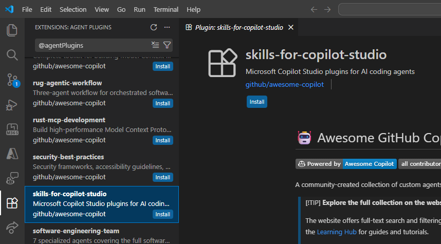

# Skills for Copilot Studio

A plugin for [Claude Code](https://docs.anthropic.com/en/docs/claude-code), [GitHub Copilot CLI](https://docs.github.com/en/copilot), [VS Code](https://code.visualstudio.com/), and [Google Antigravity](https://antigravity.google/) that enables authoring, testing, and troubleshooting [Microsoft Copilot Studio](https://aka.ms/CopilotStudio) **STANDARD** agents through YAML files — directly from your terminal or editor.

Looking for the plugin for GitHub Copilot harness agents? See the [New Microsoft Copilot Studio Plugin](https://github.com/microsoft/copilot-studio-plugin).

## Prerequisites

- [Claude Code](https://docs.anthropic.com/en/docs/claude-code), [GitHub Copilot CLI](https://docs.github.com/en/copilot), [VS Code](https://code.visualstudio.com/), or [Google Antigravity](https://antigravity.google/) (CLI, IDE, or Antigravity 2.0)
- [Node.js](https://nodejs.org/) 18+
- [VS Code](https://code.visualstudio.com/) with the [Copilot Studio Extension](https://github.com/microsoft/vscode-copilotstudio) (required for push/pull/clone operations)

## Installation

### From marketplace (Claude Code / GitHub Copilot CLI)

```bash
/plugin marketplace add microsoft/skills-for-copilot-studio
/plugin install copilot-studio@skills-for-copilot-studio
```

### Google Antigravity (CLI, IDE, or Antigravity 2.0)

```bash
# Install directly from GitHub
agy plugin install https://github.com/microsoft/skills-for-copilot-studio

# Or install from a local clone
agy plugin install /path/to/skills-for-copilot-studio
```

You can verify and toggle the installed plugin with `agy plugin list` or from the **Customizations** panel in Antigravity IDE / Antigravity 2.0.

### From VS Code Extensions Store (GitHub Copilot)

Search for **Skills for Copilot Studio** in the VS Code Extensions using the **@agentPlugins** filter to view and click **Install**.



### From a local clone

```bash
git clone https://github.com/microsoft/skills-for-copilot-studio.git

# Claude Code — load for a single session
claude --plugin-dir /path/to/skills-for-copilot-studio

# Claude Code — install persistently (user-wide)
claude plugin install /path/to/skills-for-copilot-studio --scope user

# Claude Code — install for a specific project
claude plugin install /path/to/skills-for-copilot-studio --scope project

# Antigravity — install from local clone
agy plugin install /path/to/skills-for-copilot-studio
```

## Updating

The update process depends on how you installed the plugin:

| Interface | Update Method | Details |
|-----------|--------------|--------|
| **Claude Code CLI** | Auto-update (recommended) | Marketplace plugins update automatically. No action needed. |
| **GitHub Copilot CLI** | Manual | Run `/plugin update skills-for-copilot-studio` in an interactive session, or `copilot plugin update skills-for-copilot-studio` from the terminal. |
| **VS Code** | Extension auto-update | VS Code handles updates automatically when extension auto-update is enabled in settings. |
| **Google Antigravity** | Manual | Re-run `agy plugin install https://github.com/microsoft/skills-for-copilot-studio` (or `git pull` and reinstall from your local clone). |

## Usage

The plugin provides four sub-agents, each backed by a specialized agent:

```
/copilot-studio:copilot-studio-manage       Clone, push, pull, and sync agent content between local files and the cloud
/copilot-studio:copilot-studio-author       Create and edit YAML (topics, actions, knowledge, triggers, variables)
/copilot-studio:copilot-studio-test         Test published agents — point-tests, batch suites, or evaluation analysis
/copilot-studio:copilot-studio-advisor Design guidance, agent review, and troubleshooting
```

In **Google Antigravity**, describe your Copilot Studio task in natural language and the coordinator automatically delegates to the appropriate role (`manage`, `author`, `test`, or `advisor`) using the bundled agent definitions.

## Quick Start

```bash
# Clone an agent from the cloud (guided flow — opens browser for sign-in)
/copilot-studio:copilot-studio-manage clone

# Design and build topics
/copilot-studio:copilot-studio-author Create a topic that handles IT service requests

# Pull latest, push your changes
/copilot-studio:copilot-studio-manage pull
/copilot-studio:copilot-studio-manage push

# Publish in Copilot Studio UI, then test
/copilot-studio:copilot-studio-test Send "How do I request a new laptop?" to the published agent

# Get design advice and review
/copilot-studio:copilot-studio-advisor Review my agent for improvements and known pitfalls
```

See [SETUP_GUIDE.md](SETUP_GUIDE.md) for a full end-to-end walkthrough including validation, testing options, and troubleshooting.


## Disclaimer

This plugin is an experimental research project, not an officially supported Microsoft product. The Copilot Studio YAML schema may change without notice. Always review and validate generated YAML before pushing to your environment — AI-generated output may contain errors or unsupported patterns.

## Contributing

See [CONTRIBUTING.md](CONTRIBUTING.md) for local development setup, building bundled scripts, and project structure.
